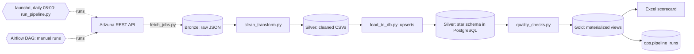
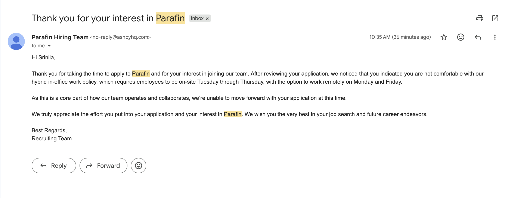

# Job Market Analytics Pipeline


A daily ELT pipeline that collects U.S. data and software job postings from the **Adzuna REST API**,
cleans and models them in **PostgreSQL** (Bronze → Silver → Gold medallion), checks their quality,
and publishes analysis-ready views and an **Excel** KPI scorecard. An **Apache Airflow** DAG and a
**Docker Compose** stack package the same pipeline.

> Every number in this README is reproducible with `docs/metrics.sql` against the live database.
> Figures are dated; re-run the SQL before quoting them elsewhere.

## Status

| Component | Status |
|---|---|
| Daily ELT (Bronze → Silver → Gold), scheduled with launchd | **Running.** 20 consecutive daily runs (Sep 22 – Oct 11, 2026), each passing the quality checks |
| Gold materialized views + run log (`ops.pipeline_runs`) | **Built.** Every daily run refreshes Gold and logs itself |
| Excel KPI scorecard (live formulas) | **Built** |
| Airflow DAG (10 tasks) + Docker Compose stack | **Built and validated through manual runs.** Its own schedule is paused: Docker stops when a laptop sleeps (see Roadmap) |
| Tests | 12 pytest tests on the skill extractor, run by GitHub Actions on every push |
| Power BI report (DAX) | **Not built.** Draft Power Query and DAX measures are in `powerbi/`, untested |
| Slack alerts | **Not configured.** The DAG has the callback; no webhook is connected |

## Architecture



Left to right: the Adzuna API feeds a Bronze folder of raw JSON; a transform step produces cleaned
CSVs; a loader upserts them into a PostgreSQL star schema; quality checks gate the run; four Gold
materialized views are refreshed; the Excel scorecard reads from Gold; a run-log table records
each run. The same steps run either from `run_pipeline.py` (scheduled with launchd) or from the
Airflow DAG.

| Layer | Contents | Location |
|---|---|---|
| Bronze | Raw API responses, timestamped | `data/raw/*.json` |
| Silver | Cleaned CSVs; star schema (`jobs_fact`, `companies_dim`, `locations_dim`, `skills_dim`, `job_skills_bridge`) | `data/processed/`, PostgreSQL |
| Gold | `gold.fct_jobs`, `gold.fct_job_skills`, `gold.skill_demand_by_role`, `gold.salary_by_state_role` | PostgreSQL |
| Ops | `ops.pipeline_runs` (status, failed task, row counts per run) | PostgreSQL |

## Results

As of **2026-10-11** (`docs/metrics.sql`):

| Metric | Value |
|---|---|
| Postings / companies | 20,311 / 4,957 |
| Collected per daily run | 2,250 (15 searches × 3 pages × 50 results) |
| Posted in the last 90 days | 96.3% (52.6% in the last 14 days) |
| Role families | 9; 0.6% unclassified |
| Postings with an employer-stated salary | 986 (4.9%); median $126,000 |
| Salary values that are Adzuna estimates | 95.1% (kept separate and excluded from salary statistics) |
| Distinct skills / postings with 1+ skill | 196 / 32.6% |
| Quality-check passes | 20 of 20 consecutive daily runs (Sep 22 – Oct 11) |

Reproduce the reliability figure from the scheduler log:

```bash
grep -E "All quality checks passed|FAILED" data/logs/cron.log | tail -n 20
```

## Data quality decisions

- **Salaries.** Adzuna returns model-estimated salaries alongside real ones. Each posting gets a
  `salary_basis` (disclosed / estimated / unknown), and salary statistics use employer-stated
  values only.
- **Missing values.** pandas NaN reached PostgreSQL as numeric NaN and as the text "NaN". The loader
  now writes NULL, and `quality_checks.py` fails the run if NaN values reappear.
- **Skill extraction.** Rule-based dictionary matching. Ambiguous names ("Go", "R", "Teams",
  "Spring", "Rest") count only when written in a skill-list context, and different spellings are
  merged (AWS / Amazon Web Services). `pytest` covers the known false-positive cases, and sampled
  matches were reviewed by hand before any skill statistic was quoted.
- **Checks after every load.** Zero jobs, empty titles, duplicate source IDs and NaN salary values
  fail the run.

## Orchestration

**Scheduled today:** `src/run_pipeline.py` runs the steps in order (fetch → clean → load → quality
checks → Gold refresh → run log). On any failure it records the failed step in `ops.pipeline_runs`
and exits non-zero. A launchd job runs it daily at 08:00; if the laptop is asleep, launchd runs it
on wake, so finish times vary between about 8 a.m. and 12:30 p.m.

**Airflow DAG** (`dags/job_market_pipeline.py`): 10 tasks in four groups, daily 06:00
`America/Chicago`.

```
bronze:   fetch_adzuna >> validate_raw
silver:   clean_transform >> validate_silver
gold:     load_postgres >> refresh_gold >> quality_checks
publish:  export_excel >> log_run_metrics >> notify_success
```

Failure handling: per-task retries (fetch: 3 × 10 min), execution timeouts, `max_active_runs=1`
(scripts read the newest file, so runs must never overlap), `AirflowFailException` in the
validation gates (no pointless retries), and a `failed` row in `ops.pipeline_runs`. A Slack
callback exists but needs a webhook connection (`slack_webhook`) before it sends anything.

## Quick start

```bash
# 1. Environment
python -m venv .venv && source .venv/bin/activate
pip install -r requirements.txt
cp .env.example .env            # fill in Adzuna + Postgres credentials

# 2. Database (fresh install only: init_db.sql DROPs tables)
createdb job_market
psql job_market -f src/db/init_db.sql
psql job_market -f src/db/gold_layer.sql

# 3. Run once by hand
python src/run_pipeline.py      # fetch -> clean -> load -> checks -> Gold refresh -> run log
python src/export/export_excel.py

# 4. Tests
pip install pytest && python -m pytest tests/ -q
```

Existing install? Follow `docs/MIGRATION.md`.

### Docker (PostgreSQL + Airflow + nightly backup)

```bash
cd docker && ./make-env.sh && docker compose build && docker compose up -d
```

See `docs/DOCKER.md`. Containers stop when the host sleeps, so a daily schedule needs an
always-on machine.

## Excel scorecard

`python src/export/export_excel.py` writes `output/excel/job_market_scorecard_<date>.xlsx`: a KPI
scorecard and role summary driven by live formulas (COUNTIFS, AVERAGEIFS, MEDIAN) over Excel
Tables, a skill × role heatmap, and a salary-by-state grid. A native PivotTable can be added from
`tblJobs` (Insert > PivotTable).

## Screenshots




## Known limitations

- Adzuna's search API truncates descriptions (about 500 characters), so skills come from a snippet:
  only 32.6% of postings have a detected skill, and skill counts are lower bounds, not demand.
- `role_family` is a title-keyword heuristic. Check the "Other" share.
- Salary statistics rest on the 4.9% of postings that state a salary.
- About 6.8% of postings have no state (Adzuna returns a bare "US" location).
- Skill extraction is dictionary matching, not a trained model; treat counts as directional.

## Roadmap

- Run the Docker/Airflow stack on an always-on machine and publish scheduled-run reliability once
  there is a clean week of runs.
- Build the Power BI report from `powerbi/` (needs Windows) and test the DAX measures.
- Connect a Slack webhook and test the failure alert.

## Layout

```
dags/                  Airflow DAG
src/ingestion/         Adzuna fetch (Bronze)
src/transform/         clean_transform + skill extractor (Silver)
src/db/                init_db.sql, gold_layer.sql, load_to_db.py, gold_ops.py, quality_checks.py,
                       one-time fixes (migrate_salary_flag.py, rebuild_skills.py, fix_nan_values.py)
src/export/            export_excel.py
src/run_pipeline.py    scheduled entry point
powerbi/               draft Power Query + DAX (not built)
docs/                  metrics.sql, MIGRATION.md, DOCKER.md, POWERBI.md
docker/                Dockerfile, docker-compose.yml, make-env.sh
tests/                 skill-extractor tests
.github/workflows/     CI (pytest)
config/config.json     search terms, pages
```
