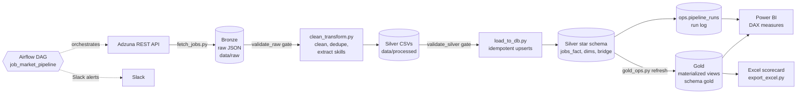

# Job Market Analytics Pipeline

Daily ELT of live U.S. data / software job postings from the **Adzuna REST API** into
**PostgreSQL** through a **Bronze → Silver → Gold medallion architecture**, orchestrated by
**Apache Airflow**, served to **Power BI (DAX)** and an **Excel** KPI scorecard.

> Numbers in this README come from `docs/metrics.sql` run against the live database. See
> [Results](#results) - nothing is quoted that the SQL can't reproduce.

## Architecture



**Diagram description (for alt text / interviews):** left to right, the Adzuna API feeds a
Bronze folder of raw JSON; a validation gate checks freshness and volume; a transform step
produces Silver CSVs; a second gate checks row counts; a loader upserts into a PostgreSQL
star schema; four Gold materialized views are refreshed; Power BI and an Excel scorecard
read from Gold. A run-log table records every run's outcome and feeds a pipeline-health
panel. One Airflow DAG orchestrates every step and posts failures to Slack.

| Layer | Contents | Location |
|---|---|---|
| Bronze | Raw API responses, timestamped | `data/raw/*.json` |
| Silver | Cleaned CSVs; star schema (`jobs_fact`, `companies_dim`, `locations_dim`, `skills_dim`, `job_skills_bridge`) | `data/processed/`, PostgreSQL |
| Gold | `gold.fct_jobs`, `gold.fct_job_skills`, `gold.skill_demand_by_role`, `gold.salary_by_state_role` | PostgreSQL |
| Ops | `ops.pipeline_runs` (status, row counts per run) | PostgreSQL |

## Airflow DAG

`dags/job_market_pipeline.py` - 10 tasks, daily 06:00 `America/Chicago`.

```
bronze:   fetch_adzuna >> validate_raw
silver:   clean_transform >> validate_silver
gold:     load_postgres >> refresh_gold >> quality_checks
publish:  export_excel >> log_run_metrics >> notify_success
```

Failure handling: per-task retries (fetch: 3 x 10 min), execution timeouts, `max_active_runs=1`
(scripts read the *newest* file, so runs must never overlap), `AirflowFailException` in the
validation gates (no pointless retries), Slack alert on retry and on final failure, and a
`failed` row in `ops.pipeline_runs`. Alerting is best-effort and can never fail a run.

## Quick start

```bash
# 1. Pipeline environment
python -m venv .venv && source .venv/bin/activate
pip install -r requirements.txt
cp .env.example .env            # fill in Adzuna + Postgres credentials

# 2. Database (fresh install only - init_db.sql DROPs tables!)
createdb job_market
psql job_market -f src/db/init_db.sql
psql job_market -f src/db/gold_layer.sql   # new installs; existing ones: docs/MIGRATION.md

# 3. Run once by hand to confirm everything works
python src/run_pipeline.py      # bronze -> silver -> load -> checks
python src/db/gold_ops.py refresh
python src/export/export_excel.py
```

Existing deployment? Follow `docs/MIGRATION.md` instead (NaN-salary backfill, salary-flag migration, retiring launchd).

### Run Airflow (separate virtualenv)

```bash
python -m venv ~/airflow-venv && source ~/airflow-venv/bin/activate
pip install -r requirements-airflow.txt   # use the official constraints file for your Python version
export AIRFLOW_HOME=~/airflow
export AIRFLOW__CORE__DAGS_FOLDER=$PWD/dags
export JOB_MARKET_HOME=$PWD
export PIPELINE_PYTHON=$PWD/.venv/bin/python   # interpreter that has pandas/psycopg2
airflow standalone                              # prints the admin password
```

Slack: create an Incoming Webhook, then in Airflow **Admin > Connections** add a *Slack
Incoming Webhook* connection with id `slack_webhook` (host `https://hooks.slack.com/services`,
password = the `T…/B…/…` part). Check field names against the provider docs for your version.

Airflow only runs while its scheduler runs. For real unattended operation, host it on an
always-on machine (e.g. Docker Compose on a small VM).

## Power BI

`powerbi/queries.pq` (Power Query) loads `gold.fct_jobs`, `gold.fct_job_skills` and
`ops.pipeline_runs`. `powerbi/measures.dax` holds a calculated date table, 5 calculated columns
and 39 measures grouped as Core, Salary, Trend, Skills, Pipeline health and KPI formatting, plus
reconciliation queries to run in DAX query view and compare against `docs/metrics.sql`.

Scheduled refresh of a local Postgres from the Power BI service needs an on-premises data gateway.

## Excel

`python src/export/export_excel.py` writes `output/excel/job_market_scorecard_<date>.xlsx`:
KPI scorecard and role summary driven by live formulas over `tblJobs`/`tblSkills`/`tblRuns`,
a skill x role heatmap, and a salary-by-state grid. For a native PivotTable, use
*Insert > PivotTable > tblJobs*, or load `gold.skill_demand_by_role` with Power Query.

## Data quality

`quality_checks.py` fails the run on: zero jobs, empty titles, duplicate source IDs, NaN salary
values. Bronze and Silver gates in the DAG fail on stale files, low volume or empty outputs.
`pytest tests/` covers the skill extractor's known false-positive cases.

## Known limitations

- Skill extraction is rule-based dictionary matching, not a trained model; precision is measured
  by hand (`docs/metrics.sql`, section 5).
- `role_family` is a title-keyword heuristic; check the `Other` share.
- Adzuna estimates most postings' salaries itself; those are flagged (`salary_is_predicted`) and
  excluded, so salary statistics rest on the small share of postings that state a salary.
- Adzuna's search API truncates descriptions (~500 characters), so skills are extracted from a
  snippet, not the full posting; counts understate real requirements.
- Jobs without a source ID dedupe by a hash only inside a single run's batch.

## Results

_Fill from `docs/metrics.sql` (record the date):_ postings, companies, states, days of history,
run success rate, % with salary, % with 1+ skill, extraction precision sample.

## Layout

```
dags/                  Airflow DAG
src/ingestion/         Adzuna fetch (Bronze)
src/transform/         clean_transform + skill extractor (Silver)
src/db/                init_db.sql, gold_layer.sql, load_to_db.py, gold_ops.py, quality_checks.py,
                       migrate_salary_flag.py, rebuild_skills.py (one-time fixes)
src/export/            export_excel.py
powerbi/               queries.pq, measures.dax
docs/                  metrics.sql, MIGRATION.md, COMMIT_PLAN.md
tests/                 extractor tests
config/config.json     search terms, pages
```
